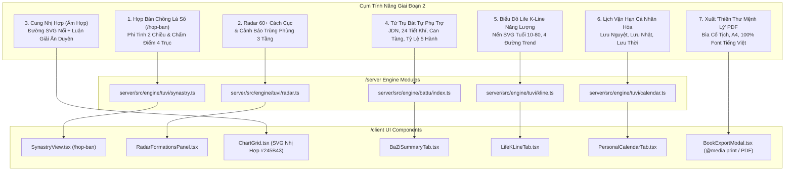

# Implementation Plan: Stage 2 - Academic Deep-Dive & B2C Viral Features

Mở rộng nền tảng `tuvilaso_WEB` với cụm 7 tính năng học thuật chiều sâu & trải nghiệm B2C viral, kế thừa Design System Cổ Tịch Trung Hoa (Tuyên Chỉ / Sơn Mài / Song Biên / Ấn Triện / Không AI-slop) và Master's Studio đã hoàn thành ở Giai đoạn 1.

---

## 1. Kiến Trúc Tổng Thể Giai Đoạn 2

---

## 2. Kế Hoạch Hiện Thực Hóa Từng Hạng Mục

### Hạng mục 1: Hợp Bàn Chồng Lá Số (`/server/src/engine/tuvi/synastry.ts` + `SynastryView.tsx`)
- **API:** `POST /api/laso/synastry`
- **Thuật toán Phi Tinh 2 chiều:**
  - $A \to B$: Lấy Thiên Can của `Mệnh`, `Phu Thê`/`Nô Bộc`, `Tài Bạch` của A; áp dụng Tứ Hóa để xác định vị trí sao Hóa Lộc, Quyền, Khoa, Kỵ rơi vào cung nào của B (kèm cung Xung khi Kỵ nhập).
  - $B \to A$: Chiều ngược lại.
- **Tương hợp Mệnh & Nạp Âm:** Tam Hợp, Lục Hợp, Lục Xung, Lục Hại giữa Địa Chi Mệnh & Chi Năm; sinh khắc Nạp Âm.
- **Chấm điểm 4 trục:**
  1. *Duyên Nợ & Thấu Hiểu*
  2. *Hỗ Trợ Tài Lộc*
  3. *Đồng Hành Sự Nghiệp*
  4. *Mức Độ Xung Khắc / Áp Lực*

### Hạng mục 2: Radar 60+ Cách Cục & Cảnh Báo Trùng Phùng (`radar.ts` + `RadarFormationsPanel.tsx`)
- Quét tự động 60+ cách cục phân loại `cat_cach`, `hung_cach`, `dac_biet`.
- Cảnh báo "Trùng Phùng" 3 tầng: Song Lộc/Tam Lộc, Song Kỵ/Tam Kỵ, Đại Vận Kỵ xung Lưu Niên, Lộc Phùng Xung Phá.
- Tương tác: Bấm vào thẻ cách cục tự động highlight các cung liên quan trên lá số.

### Hạng mục 3: Đường Nhị Hợp (Ám Hợp)
- 6 cặp Nhị Hợp: Tý-Sửu, Dần-Hợi, Mão-Tuất, Thìn-Dậu, Tỵ-Thân, Ngọ-Mùi.
- Công tắc "Nhị Hợp" trên thanh điều khiển: vẽ nét đứt màu Thanh Ngọc (`#245B43`) từ cung đang chọn sang cung Nhị Hợp.
- Luận giải ý nghĩa Nhị Hợp trong Tab Chi Tiết Cung.

### Hạng mục 4: Phụ Trợ Tứ Trụ Bát Tự (`/server/src/engine/battu/`)
- Trụ Năm, Tháng: chuẩn 24 Tiết Khí (Lập Xuân, Tiết lệnh).
- Trụ Ngày: Julian Day Number (JDN).
- Trụ Giờ: Ngũ Thử Độn.
- Can Tàng & Tỷ lệ 5 hành: Kim, Mộc, Thủy, Hỏa, Thổ (tổng = 100%).
- Nhật Chủ, Đắc Lệnh/Đắc Địa, gợi ý Hỷ/Dụng Thần.

### Hạng mục 5: Biểu Đồ Life K-Line Năng Lượng (`kline.ts` + `LifeKLineTab.tsx`)
- Nến năng lượng tuổi 10-80 (theo Đại Vận hoặc từng năm).
- SVG thuần: Tăng = Thanh Ngọc (`#245B43`), Giảm = Chu Sa (`#9E2A22`).
- 4 lớp đường: Tổng Vận, Tài Lộc, Sự Nghiệp, Tình Duyên/Sức Khỏe.
- Tương tác tooltip, click chuyển Đại Vận, xuất ảnh PNG kèm Ấn Triện.

### Hạng mục 6: Lịch Vận Hạn Cá Nhân Hóa (`calendar.ts` + `PersonalCalendarTab.tsx`)
- Lưu Nguyệt (1..12) & Lưu Nhật (1..30).
- Phân loại ngày: Đại Cát, Khá, Bình Hòa, Thận Trọng.
- Bấm vào ngày xem Cung Lưu Nhật, Giờ tốt Lưu Thời, Việc nên làm / tránh.

### Hạng mục 7: Xuất "Thiên Thư Mệnh Lý" PDF (`BookExportModal.tsx`)
- Preview & Edit trước khi xuất.
- Bố cục sách cổ A4, font Noto Serif / Be Vietnam Pro, không vỡ dấu tiếng Việt.
- Bìa Sách, Lá Số 4x4, Radar Cách Cục, K-Line, Luận Giải 12 Cung, Lộ trình Vận hạn & Ấn Triện Thầy.

### Hạng mục 8: Verification & Delivery
- Vitest unit tests cho tất cả engine mới.
- Playwright E2E tests bao phủ toàn bộ 7 tính năng trên Desktop & Mobile.
- Build sạch 0 lỗi, push lên GitHub `main`.
