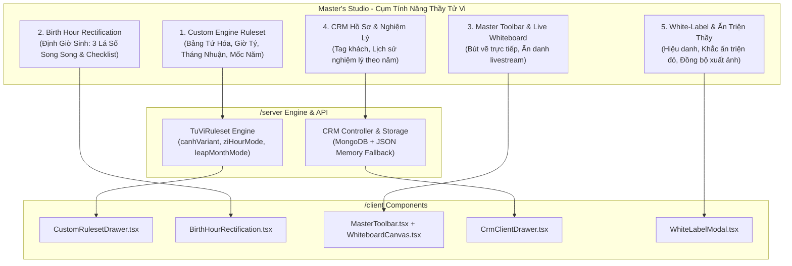

# Implementation Plan: Stage 1 - Master's Studio for Tu Vi Practitioners

Xây dựng cụm 5 tính năng chuyên sâu chuẩn mực cho giới Thầy Tử Vi trên nền tảng `tuvilaso_WEB` theo ngôn ngữ thiết kế Cổ Tịch Trung Hoa (Tuyên Chỉ / Sơn Mài / Song Biên / Ấn Triện / Không AI-slop).

---

## 1. Kiến Trúc & Các Thành Phần

---

## 2. Kế Hoạch Triển Khai Chi Tiết

### Phase 1: Engine Ruleset & Custom Phái Luật
1. Mở rộng `server/src/engine/tuvi/types.ts` & `client/src/engine/types.ts`:
   - `TuViRuleset`, `canhVariant`, `nhamVariant`, `mauVariant`, `ziHourMode`, `leapMonthMode`, `yearBoundaryMode`, `khoiVietVariant`, `luuNguyetMethod`, `schoolPreset`.
   - Cập nhật `TuViInput` nhận optional `ruleset`.
2. Cập nhật `server/src/engine/tuvi/elements.ts` & `stars.ts`:
   - Hàm `getTuHoaTable(ruleset?: TuViRuleset)` tính toán Tứ Hóa động theo các biến thể:
     - `canhVariant`: `vn_standard` (Nhật Vũ Âm Đồng), `toan_thu` (Nhật Vũ Phủ Đồng), `bac_phai_alt` (Nhật Vũ Đồng Âm).
     - `nhamVariant`: `vn_standard` (Lương Tử Phù Vũ), `toan_thu` (Lương Tử Phủ Vũ).
     - `mauVariant`: `vn_standard` (Tham Âm Bật Cơ), `toan_thu` (Tham Âm Dương Cơ).
3. Cập nhật `server/src/engine/tuvi/lunar.ts` & `index.ts`:
   - `ziHourMode`: Giờ Tý 23:00 - 00:00: `split_next_day` (Vãn Tý tính sang ngày hôm sau) vs `keep_current_day`.
   - `leapMonthMode`: `previous_month` vs `split_day_15` (1-15 tháng trước, 16-30 tháng sau) vs `next_month`.
   - `yearBoundaryMode`: `lunar_new_year` (Mùng 1 Tết Âm) vs `lichun` (Tiết Lập Xuân).
   - `khoiVietVariant`: `vn_standard` vs `bac_phai`.
4. Đồng bộ toàn bộ sang `client/src/engine/`.
5. Tạo `client/src/components/CustomRulesetDrawer.tsx`:
   - Khung song biên cổ điển, chọn 4 preset có sẵn (*Nam Phái Việt Nam*, *Bắc Phái Khâm Thiên*, *Trung Châu Phái*, *Tử Vi Toàn Thư*) + tùy chỉnh chi tiết từng Can.
   - Nút "Lưu thành Phái Luật Riêng" lưu vào DB/localStorage.

### Phase 2: CRM Quản Lý Hồ Sơ Khách Hàng & Nhật Ký Nghiệm Lý
1. Schema & Model Backend:
   - `server/src/models/ClientChart.ts` (Mongoose schema).
   - `server/src/storage/memoryStore.ts`: thêm `saveClientChart`, `getClientCharts`, `updateClientChart`, `deleteClientChart`, `addVerificationNote`, `deleteVerificationNote` (với file lưu cục bộ `data/crm_fallback.json`).
   - `server/src/config/db.ts`: wrap các hàm DB CRM kèm fallback tự động.
2. API Endpoints trong `server/src/app.ts`:
   - `GET /api/crm/charts` (tìm kiếm theo tên, năm sinh, chính tinh, tag).
   - `POST /api/crm/charts`.
   - `GET /api/crm/charts/:id`.
   - `PUT /api/crm/charts/:id`.
   - `DELETE /api/crm/charts/:id`.
   - `POST /api/crm/charts/:id/notes` (ghi chú nghiệm lý theo năm kèm trạng thái).
   - `DELETE /api/crm/charts/:id/notes/:noteId`.
3. Component `client/src/components/CrmClientDrawer.tsx`:
   - Danh sách hồ sơ khách hàng, gắn thẻ (*Gia đình*, *Doanh nhân*, *Hôn nhân*, *Khách VIP*, *Mẫu học thuật*).
   - Chi tiết hồ sơ: Bảng Nhật Ký Nghiệm Lý theo từng năm (`2024`, `2025`...) với trạng thái (*Đã ứng nghiệm*, *Đang theo dõi*, *Cần kiểm lại*).
   - Bấm vào năm nào trên nhật ký -> lá số tự động nhảy năm đối chiếu tức thì!

### Phase 3: White-Label & Ấn Triện Riêng Của Thầy
1. Type & State `MasterBrandConfig`:
   - `brandName`: Tên hiệu/phái của thầy.
   - `sealText`: 2-4 chữ Hán-Việt cho con dấu (VD: "Minh Khang", "Gia Cát").
   - `contactInfo`: Hotline / Zalo.
   - `subtitle`: Khẩu quyết hoặc dòng phụ.
   - `logoUrl`: Logo hoặc ảnh mã QR.
   - `enabled`: Bật/Tắt White-Label.
2. Component `client/src/components/WhiteLabelModal.tsx`:
   - Form cấu hình thương hiệu của thầy, lưu vào DB/localStorage.
   - Live preview con dấu ấn triện đỏ chu sa khắc đá dạng SVG.
3. Đồng bộ hiển thị:
   - Cập nhật Thiên Bàn trong `ChartGrid.tsx`: khi bật White-Label, hiển thị tên hiệu, con dấu ấn triện đỏ và thông tin của thầy.
   - Cập nhật `ExportModal.tsx`: xuất ảnh PNG 2D Canvas áp dụng thương hiệu của thầy.

### Phase 4: Master Toolbar, Chế Độ Ẩn Danh & Live Whiteboard Overlay
1. Component `client/src/components/MasterToolbar.tsx`:
   - Đặt ngay trên khung 4x4:
     - Nút "Ẩn Danh (Livestream)": che Họ Tên thành `Đương Số (Ẩn Danh)` và che ngày sinh thành `**/**/YYYY`.
     - Nút "Bút Giảng Bài (Whiteboard)": bật/tắt canvas vẽ trực tiếp.
     - Nút "Phái Luật": mở Drawer cấu hình quy tắc.
     - Nút "Hồ Sơ CRM": mở Drawer khách hàng.
     - Nút "Hiệu Danh & Ấn Triện": mở White-Label modal.
2. Component `client/src/components/WhiteboardCanvas.tsx`:
   - Lớp Canvas trong suốt phủ khít lên khung ma trận 4x4.
   - Công cụ: Bút vẽ tự do (3 màu Cổ Tịch: Chu Sa `#9E2A22`, Cổ Đồng Kim `#9A7B3E`, Thanh Ngọc `#245B43`), Khoanh tròn nhấn sao, Mũi tên chỉ hướng Phi Hóa, Hoàn tác (Undo), Xóa bảng, Chụp ảnh gộp nét vẽ.

### Phase 5: Công Cụ Định Giờ Sinh Thông Minh (Birth Hour Rectification)
1. Engine định giờ sinh `server/src/engine/tuvi/rectification.ts`:
   - Thuật toán sinh song song 3 lá số (giờ trước - giờ chính - giờ sau).
   - Bảng 8-10 tiêu chí nghiệm lý thực tế (Ngoại hình, Vị thứ anh em, Xu hướng nghề nghiệp, Hôn nhân, Biến cố gần nhất, Tính cách, v.v.).
   - Logic đối chiếu sao thực tế để chấm điểm độ khớp (%).
2. Component `client/src/components/BirthHourRectification.tsx`:
   - So sánh 3 cột Cung Mệnh, Thân, Phu Thê, Quan Lộc, Phụ Mẫu, Huynh Đệ.
   - Checklist nghiệm lý tương tác tính điểm % trực tiếp.
   - Nút "Chốt giờ này & Mở Lá Số Đầy Đủ" nạp thẳng vào lá số chính.
3. Gắn liên kết trên `Header.tsx` và điều hướng mượt mà trong `App.tsx`.

### Phase 6: Unit Test, Build & Playwright E2E Verification
1. Viết Unit Test Backend `server/tests/studio_engine.test.ts`:
   - Test các biến thể Canh/Nhâm/Mậu của Tứ Hóa.
   - Test `ziHourMode` (23h sang ngày mới vs giữ ngày cũ).
   - Test `leapMonthMode` (3 chế độ).
   - Test API CRM (CRUD, notes, search).
   - Test thuật toán chấm điểm Định Giờ Sinh.
2. Viết E2E Playwright `e2e/master_studio.spec.ts`:
   - Test Drawer Phái Luật -> đổi Tứ Hóa -> cập nhật lá số.
   - Test Định Giờ Sinh -> so sánh 3 cột -> chọn checklist -> chốt giờ sinh.
   - Test Master Toolbar: bật Ẩn danh (che tên), bật Whiteboard (vẽ canvas).
   - Test CRM: tạo hồ sơ, thêm ghi chú nghiệm lý, nhảy năm đối chiếu.
   - Test White-Label: cấu hình ấn triện riêng -> render đúng trên Thiên Bàn.
   - Test Desktop (`1440x900`) & Mobile (`390x844`).
3. Build và test sạch 100%, commit chuẩn `feat(studio): add custom ruleset, birth hour rectification, live whiteboard, CRM and white-label` và push lên GitHub.
